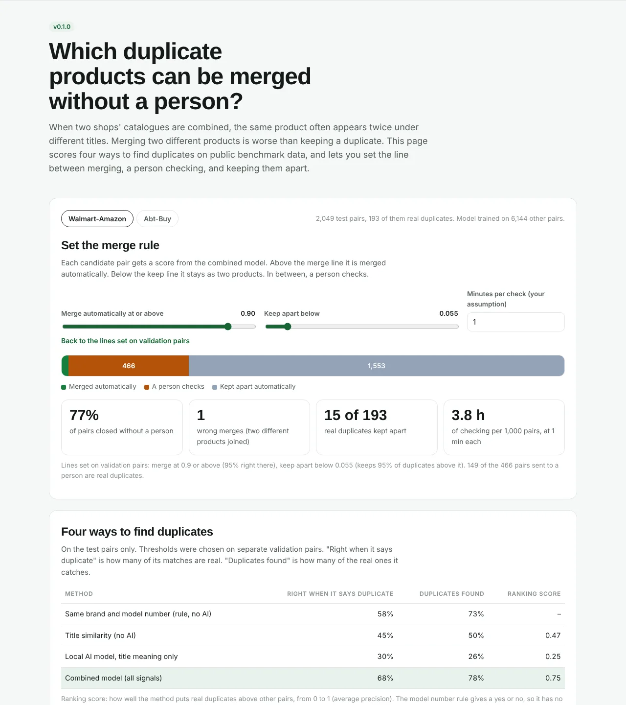

# Duplicate Product Finder

**Which duplicate products can a catalogue merge without a person checking? Four matching methods, from a simple model number rule to a local AI model, scored on two public product matching benchmarks, with a merge, check or keep-apart rule you can set yourself.**

**Current version:** 0.1.0

Live results: https://kostasxeras.com/duplicate-product-finder/



## Why this exists

When two catalogues are combined, after an acquisition, a new supplier feed or a marketplace, the same product often appears twice under different titles. Duplicates split reviews, stock and search results. But merging two different products is worse: a shopper orders a 6 ft cable and gets a 10 ft one.

Master data teams usually start with a rule (same brand and model number) and send everything else to people. The product question is how much of that checking a model can remove, at what risk.

## What it does

- Scores candidate pairs from two benchmarks: Walmart-Amazon (electronics, with brand, model number and price) and Abt-Buy (electronics, with longer titles).
- Compares four methods: the model number rule, title similarity, a local AI model's sense of title meaning, and a combined model that uses all the signals.
- Splits pairs into three bands: merge automatically, a person checks, keep apart. The lines are set on validation pairs, then applied once to test pairs.
- The results page lets you move the lines, set your own minutes per check, and read every pair with its signals.

## Main findings

Full detail in the [case study](docs/case-study.md). Test pairs only.

| Method | Walmart-Amazon: right when it says duplicate | Duplicates found | Abt-Buy: right when it says duplicate | Duplicates found |
|---|---|---|---|---|
| Same brand and model number (rule) | 58% | 73% | 93% | 68% |
| Title similarity | 45% | 50% | 71% | 59% |
| Local AI model, title meaning only | 30% | 26% | 32% | 35% |
| Combined model | 68% | 78% | 89% | 82% |

- **The value is in closing pairs, not in merging them.** With the lines set on validation pairs, 77% of Walmart-Amazon pairs (80% for Abt-Buy) are closed without a person, almost all by keeping them apart. Only 15% of Walmart-Amazon duplicates (39% for Abt-Buy) are safe to merge automatically.
- **The general AI model knows "similar", not "same".** On its own it is the weakest method, and removing it from the combined model barely changes the ranking (0.747 to 0.736 and 0.907 to 0.905). The 6 ft and 10 ft adapters below score 0.97 on its similarity, and they are different products.
- **Model numbers carry the match, and missing ones create the work.** On Abt-Buy, 61% of the pairs sent to a person lack a model number on one side, against 12% of all pairs. On Walmart-Amazon there is no such gap (27% against 24%), so this holds for one benchmark only.
- **Every signal has a cost.** A "one model number contains the other" signal found duplicates like "p-fdu4" and "p-fdu4gbsv-ef", and also caused the only wrong merge on Walmart-Amazon: a 6 ft and a 10 ft adapter, "icusb1284" and "icusb128410".

## Data

The [Walmart-Amazon and Abt-Buy benchmarks](https://github.com/anhaidgroup/deepmatcher/blob/master/Datasets.md) from the Magellan data repository, in the train, validation and test split published with the [Ditto](https://github.com/megagonlabs/ditto) research code (Apache 2.0). The labels were made by people. The candidate pairs were already filtered to similar looking products, so duplicates are about 10% of pairs here and far rarer in a real catalogue. The licence of the underlying product data is not stated.

## My role

I framed the problem, chose the methods, the three-band rule and how to set its lines, and wrote the findings. Decisions are recorded in [docs/decisions](docs/decisions).

## Run it yourself

- **Results page:** open `index.html` through any local web server, for example `python3 -m http.server`.
- **Analysis:** `npm install`, then `npm run download`, `npm run parse`, `npm run embed` (about 3 minutes on a laptop), `npm run match`, `npm run export`. A rerun from a clean folder gave an identical `data/app-data.json`.

## Repo layout

```
index.html                Results page
data/app-data.json        Test pairs, scores, signals and the method table
scripts/0-... to 5-...    Download, parse, embed, match, bands, export
docs/bands-output.txt     Raw output of the band and ablation step
docs/case-study.md        Question, approach, findings, next steps
docs/product-brief.md     Users, goals, scope
docs/decisions/           One record per real tradeoff
```
